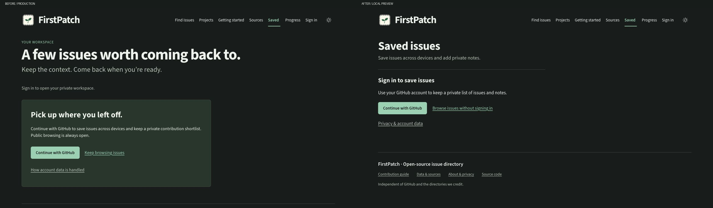
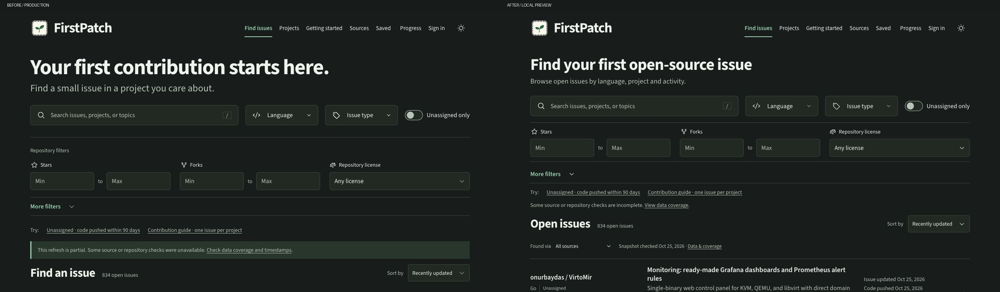
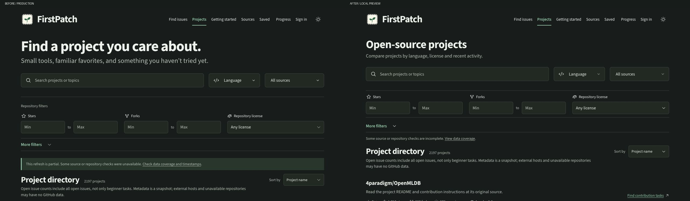
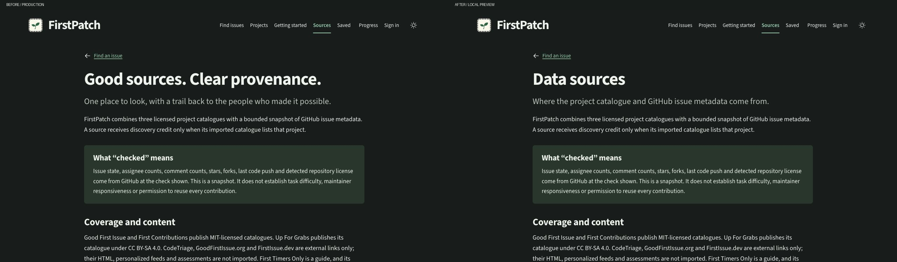

# Impeccable refinement: audit and verification

26 October 2026. Local preview only; no push, deployment, provider change or
database mutation. The existing 31 tests, build and SEO/link checks pass.

## Scope and method

The owner requested less generic UI and copy using
[Impeccable](https://impeccable.style/). Read its official
[skill](https://github.com/pbakaus/impeccable/blob/main/.agents/skills/impeccable/SKILL.md),
polish, clarify, Operate and craft-floor guidance. Its launcher was absent from
the project; context was read from DESIGN.md and the current implementation.
No global skill installation, hook setup or automatic-detector pass is claimed.

The user task is finding an issue, saving its context and following a linked PR.
This is a refinement of the approved identity, not a replacement visual system.
Only FirstPatch-authored UI copy changes; upstream issue/catalogue text and
factual privacy, source and licensing statements are preserved.

## Captured flow and findings

| Step | Surface | Finding and change | Final health |
| --- | --- | --- | --- |
| 1 | Saved, signed out | P2: four overlapping return-to-work messages and a large login card obscure the task. Name the page Saved issues, remove the eyebrow/repeated status and use an inline sign-in section. | Passed |
| 2 | Issue search | P2: oversized introduction and repeated filter chrome push the first result below the captured viewport. Use a direct heading, compact spacing and inline source status; retain visible metric filters. | Passed |
| 3 | Projects | P2: slogan-style heading and excess filter spacing delay comparison. Use Open-source projects and the shared compact filter treatment. | Passed |
| 4 | Sources | P3: the title/lede say little about the content. Use Data sources and identify catalogue/issue metadata; preserve the substantive source and rights text. | Passed |

1. Saved — production and refined UI, same signed-out state:

2. Issue search — same snapshot, default filters and collapsed disclosures:

3. Projects — same directory and default filters:

4. Sources — same provenance content and article layout:

## Visual verification

Source: production at https://firstpatch.pages.dev/, captured during this pass.
Implementation: http://127.0.0.1:4173/. Each paired source/implementation frame is
1280 × 720 pixels, CSS viewport 1280 × 720, density 1, dark theme. Each combined
image is 2560 × 748 including a 28px evidence label. No screenshot scaling was
used. The focused comparison is saved-copy-focus.png, cropped from those same
frames. Captures wait for the enhanced controls and full catalogue load; an
earlier light-theme/loading capture was rejected and replaced.

- **Typography:** Source Sans 3 and Source Code Pro remain self-hosted. Functional
  headings use a smaller fixed scale, with lighter hierarchy between heading,
  explanation and action. The sprout, navigation labels and icon family remain.
- **Spacing:** the first issue moves from y=761.14 to y=635.30; the first project
  moves from y=720.14 to y=614.30 at 1280px. More result content is visible without
  removing the requested stars/forks/license filters. The sign-in surface uses
  a rule and whitespace instead of a filled container.
- **Color:** original ivory/forest tokens remain in both themes. Removed the
  thick colored edge/fill from the partial-source notice. Existing semantic
  contrast checks still pass: 5.36:1 light, 6.08:1 dark minimum text contrast.
- **Assets:** approved sprout, existing Phosphor icons and font files are reused.
  No generated or approximated visual asset was added.
- **Copy:** functional page names, action-specific sign-in copy and explicit empty
  states replace slogans. PR guidance distinguishes author/repository checks
  from the issue relationship, which FirstPatch does not verify as a closure.

The first editor attempt put grid on native details; its generated content box
left both forms stacked in a half-width column. This P2 was corrected with an
explicit saved-editors wrapper. Rechecked columns measure x=77.44 and x=483.44,
374px each at 1280px; the 320px layout has one 284px column.

## Interaction and responsive evidence

- Minimum stars=100 produced 691 issues. Reset restored 834 and hid the reset
  action again. The accessible repository-filter region remains named.
- Enter opened an issue disclosure. Save issue opened the rewritten sign-in
  dialog; Escape closed it and returned focus to Save issue. No OAuth sign-in or
  real-account mutation was performed during this UI pass.
- An explicitly labeled in-memory fixture exercised save, status/note update,
  reload persistence and PR submission. Its simulated PR appeared as 1 submitted,
  1 open, 0 merged in Progress. These are UI-fixture results, not a real PR or
  real GitHub verification. See 05-saved-fixture-desktop.png,
  06-progress-fixture.png and 07-settings-fixture.png.
- At 320px, Issues, Projects, Sources and Saved had document scroll width equal
  to 320. Projects also reflowed at 768px with scroll width 768. Signed-in Saved
  stacked the two editors; visible navigation/theme targets measured at least
  44 × 44px. See 08-saved-fixture-mobile.png (light) and
  09-saved-guest-mobile.png (dark).
- Normal-flow console warnings/errors were empty before fault injection.
  Blocking the local account API displayed the connection error and Try again.
  After unblocking, Retry restored the guest gate and hid the error/retry.
  Network overrides were removed after the exercise.
- All 31 tests pass; 113 generated HTML pages / 108 indexable pages and 34,939
  local references pass the build/metadata/canonical/JSON-LD/sitemap checks.
  Private account pages remain noindex and absent from the sitemap.

## Delivery gate and limits

Manual Impeccable clarify/polish review passed for the tested scope. Anti Slop
Hard Gate, Purpose Gate, Liveliness and Craftsmanship checks pass: controls work,
the existing identity is retained, copy names real tasks, and no new decorative
asset, fabricated metric or endorsement claim was added. No automatic detector
score, exhaustive accessibility certification, real PR verification, production
release or Google indexing result is claimed.

Full screen-reader use, localization expansion and a dedicated 200% browser-zoom
pass were not tested. Existing live infrastructure and daily jobs are unchanged.
